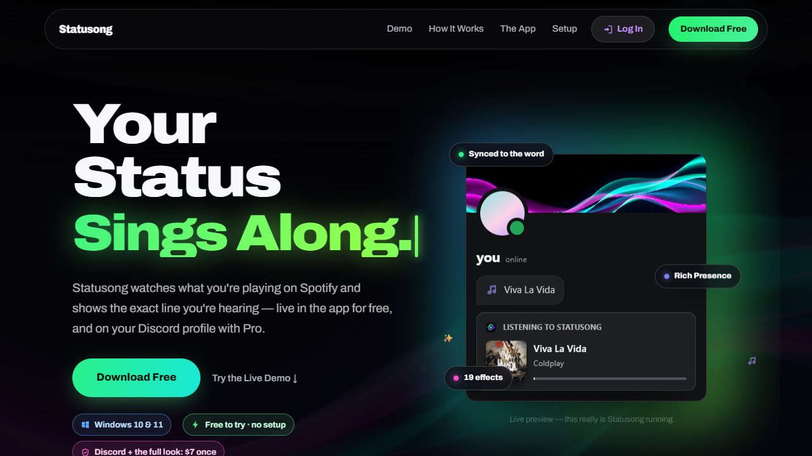

 

 

## What is it?

**Statusong** shows the lyric you're hearing right now on your **Discord status**: live, line by line, in time with the music. Spotify, Apple Music or your browser. Windows 10 and 11.

## Download

1. Press **Download for Windows** above (or get `Statusong-Setup.exe` from [Releases](https://github.com/IdanKol/statusong/releases/latest)).
2. Run it. It installs in a few seconds, no admin rights.
3. Play a song. The lyrics show up by themselves.

> The installer is new and not signed yet. If Windows shows a warning, press **More info**, then **Run anyway**.

## What's inside

 

 

## Your privacy

**We never take your token. Your information stays on your computer. We have no access to it.**

 

  
This repository holds the downloads. © Statusong. All rights reserved. Not affiliated with Spotify, Apple, YouTube or Discord. Lyrics via <a href="https://lrclib.net">LRCLIB</a>.

