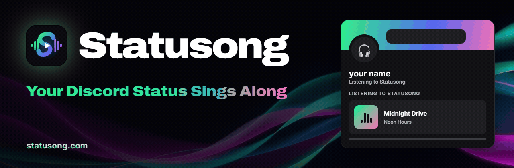
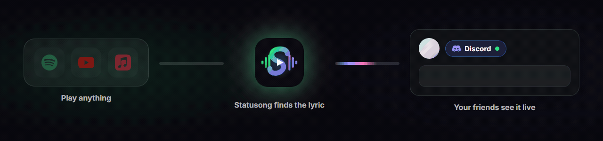
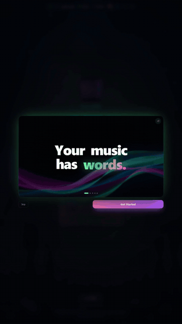
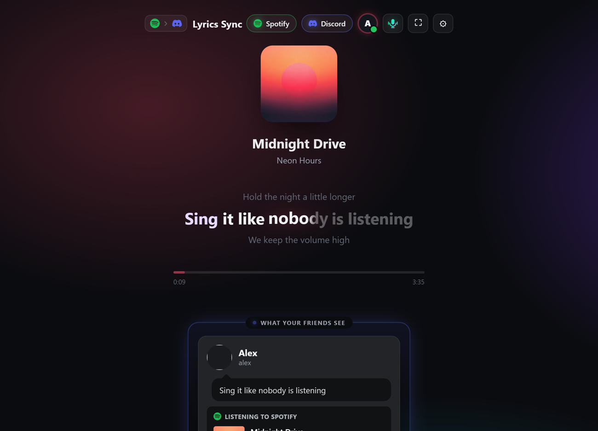
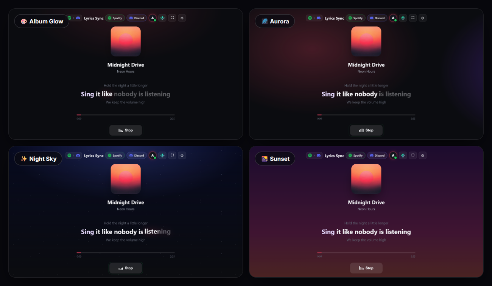
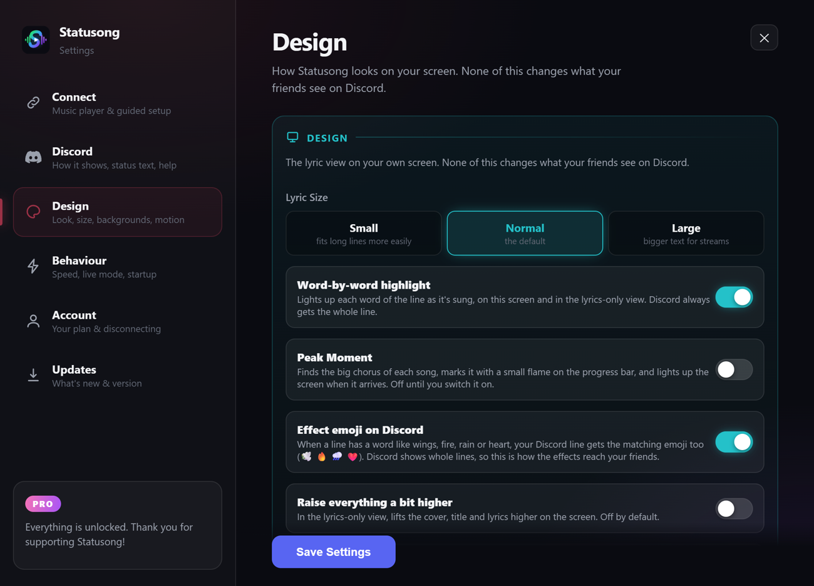
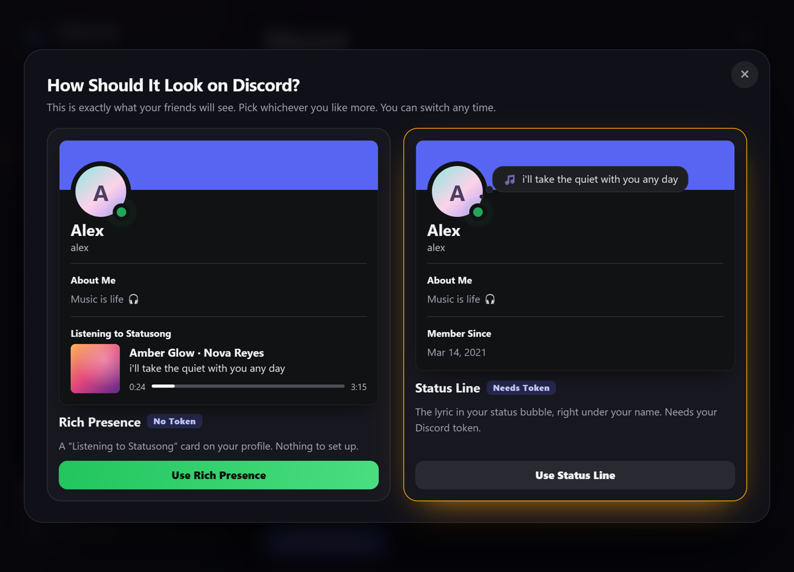
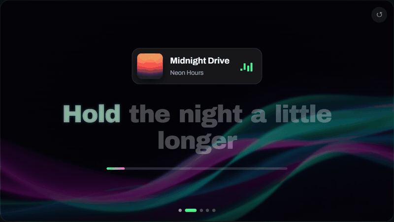
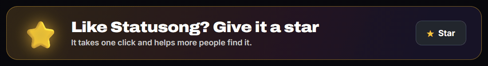

<div align="center">



<br/>

<a href="https://github.com/IdanKol/statusong/releases/latest/download/Statusong-Setup.exe"></a>
&nbsp;
<a href="https://discord.gg/statusong"></a>
&nbsp;
<a href="https://statusong.com"></a>

<br/>

<sub>Free · Windows 10 and 11 · installs in seconds · no admin rights</sub>

</div>

<br/>

<div align="center">

</div>

<br/>

## What is it?

**StatuSong** is free software for Windows that syncs your Spotify lyrics to your **Discord status**, live, and can even show them on your desktop. It shows the lyric you're hearing right now: line by line, in time with the music. It works with Spotify, Apple Music, YouTube and almost anything else that plays music on your PC.

<br/>

## New in 1.5

- **Kinetic lyrics:** the words pile up as they are sung, and the biggest word fills the screen.
- **A colour for every word:** White, Album colours, Sunset, Ocean, Neon or Rainbow.
- **Lyrics on your desktop (Windows 11):** over your wallpaper, under your icons, gone when the music stops. Off until you switch it on.
- **Cinema clock position** (left, middle or right, top or bottom) and a top bar that slides in smoothly.
- No token needed: pick Rich Presence and your lyric shows on a "Listening to StatuSong" card. The status line is optional.

More on [statusong.com/news](https://statusong.com/news).

<br/>

<div align="center">

</div>

### 🎧 Works with what you already use

<div align="center">


</div>

If it shows up in the Windows media controls (the little player in the volume pop-up), StatuSong sees it. Video titles like *"Artist - Song [Official Video]"* are cleaned up, so the lyrics are found for YouTube too. Not sure what's playing? Press **Identify a Song**, play it near your mic, and StatuSong names it, like Shazam but built in.

<br/>

## See it in action

<div align="center">

<br/><sub>A quick look inside the app.</sub>
</div>

<br/>

## How it looks

<div align="center">

<br/><sub>The lyric lights up word by word, and the card shows what your friends see.</sub>
</div>

<br/>

### 🎨 Design

Pick the scene behind your lyrics, the size of the text, and which effects play.

<div align="center">

</div>

<br/>

<div align="center">

</div>

<br/>

### 💬 Your friends, your choice

Show the lyric as a **Listening to StatuSong** card, or right in your status bubble. You pick, and you can switch any time.

<div align="center">

</div>

<br/>

## Download

<div align="center">

</div>

1. Press **Download for Windows** above, or get `Statusong-Setup.exe` from [Releases](https://github.com/IdanKol/statusong/releases/latest).
2. Run it. It installs in a few seconds.
3. Play a song. The lyrics show up by themselves.

> The installer is new and not signed yet. If Windows shows a warning, press **More info**, then **Run anyway**.

### Install from the terminal

Prefer a command? Both download the latest installer and start it.  
**PowerShell**

```powershell
$ProgressPreference = 'SilentlyContinue'; irm https://github.com/IdanKol/statusong/releases/latest/download/Statusong-Setup.exe -OutFile "$env:TEMP\Statusong-Setup.exe"; Start-Process "$env:TEMP\Statusong-Setup.exe"
```

**CMD**

```bat
curl -L -o "%TEMP%\Statusong-Setup.exe" https://github.com/IdanKol/statusong/releases/latest/download/Statusong-Setup.exe && start "" "%TEMP%\Statusong-Setup.exe"
```

Want to check the file first? Compare its SHA-256 with the one in the [release notes](https://github.com/IdanKol/statusong/releases/latest):

```powershell
(Get-FileHash "$env:TEMP\Statusong-Setup.exe").Hash
```

<br/>

<div align="center">

</div>

<br/>

## 🔒 Your privacy

- 🚫 **We never take your token.**
- 💻 **Your information stays on your computer.**
- 🙈 **We have no access to it.**

<br/>

<div align="center">
<a href="https://github.com/IdanKol/statusong"></a>
<br/>
<a href="https://github.com/IdanKol/statusong/stargazers"></a>
</div>

<br/>

## About

StatuSong is made by **iDAN** ([@idan2133](https://discord.gg/statusong) on Discord). Questions, ideas or feedback? Come say hi in the [Discord server](https://discord.gg/statusong). Refunds within 7 days: just send a DM.

<div align="center">
<br/>
<sub>© StatuSong. All rights reserved. Not affiliated with Spotify, Apple, YouTube or Discord. Lyrics via <a href="https://lrclib.net">LRCLIB</a>.</sub>
</div>
