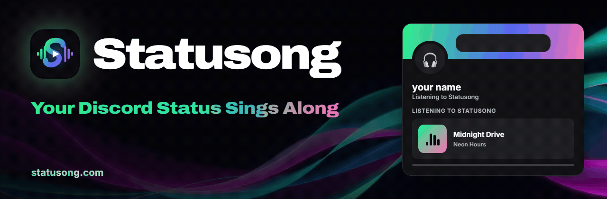
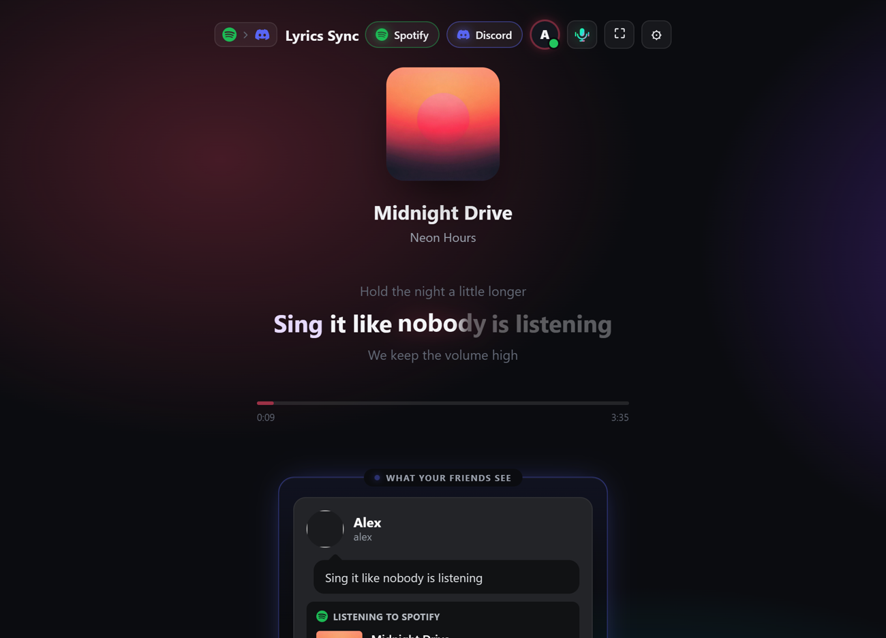
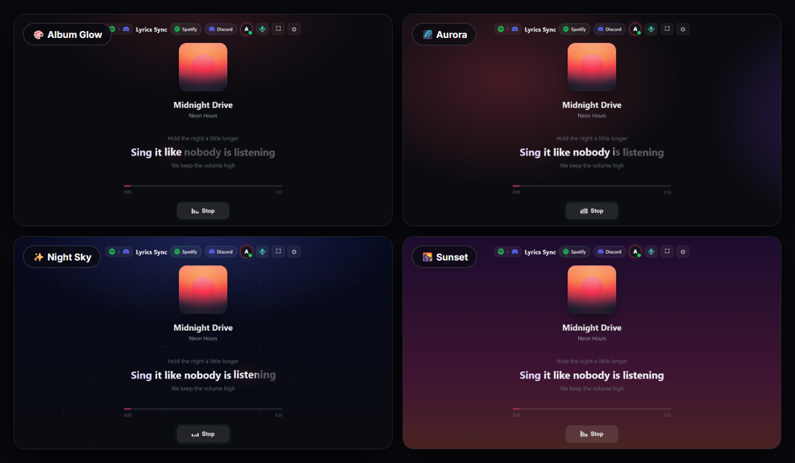
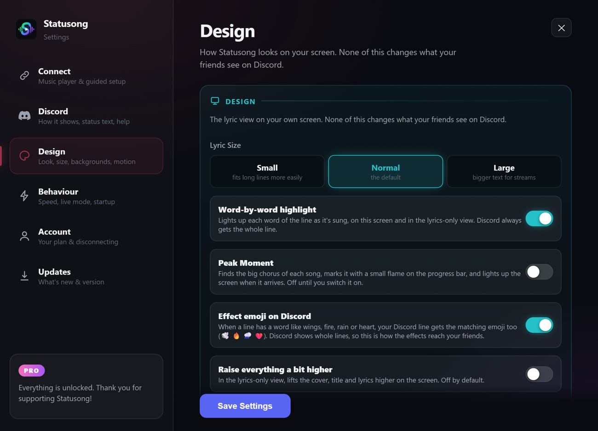
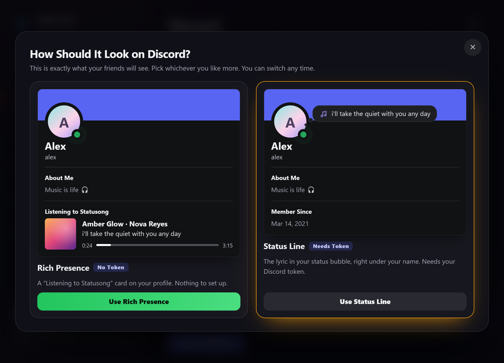

 

&nbsp;

&nbsp;

 

Free · Windows 10 and 11 · installs in seconds · no admin rights

 

## What is it?

**Statusong** shows the lyric you're hearing right now on your **Discord status**: live, line by line, in time with the music. It works with Spotify, Apple Music and your browser.

 

 

## How it looks

 The lyric lights up word by word, and the card shows what your friends see.

 

### 🎨 Design

Pick the scene behind your lyrics, the size of the text, and which effects play.

 

 

### 💬 Your friends, your choice

Show the lyric as a **Listening to Statusong** card, or right in your status bubble. You pick, and you can switch any time.

 

## Download

1. Press **Download for Windows** above, or get `Statusong-Setup.exe` from [Releases](https://github.com/IdanKol/statusong/releases/latest).
2. Run it. It installs in a few seconds.
3. Play a song. The lyrics show up by themselves.

> The installer is new and not signed yet. If Windows shows a warning, press **More info**, then **Run anyway**.

 

 

## Your privacy

**We never take your token. Your information stays on your computer. We have no access to it.**

 

## About

Statusong is made by **iDAN** ([@idan2133](https://discord.gg/R53rh6RpzG) on Discord). Questions, ideas or feedback? Come say hi in the [Discord server](https://discord.gg/R53rh6RpzG). Refunds within 7 days: just send a DM.

 
© Statusong. All rights reserved. Not affiliated with Spotify, Apple, YouTube or Discord. Lyrics via <a href="https://lrclib.net">LRCLIB</a>.

